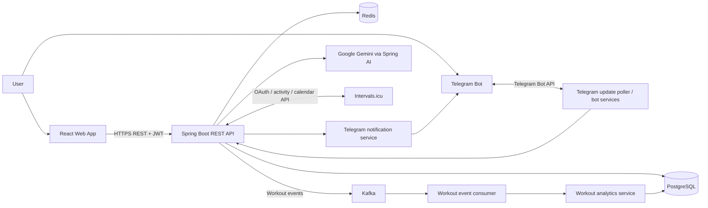
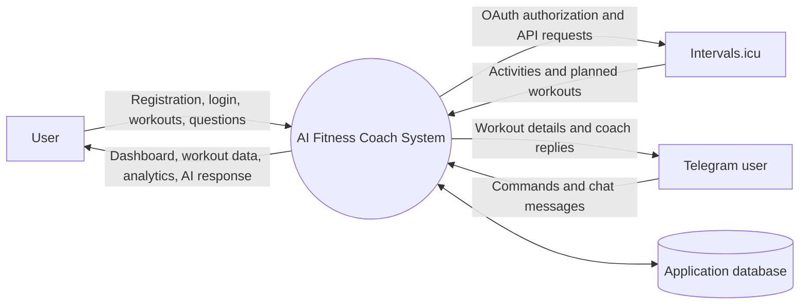
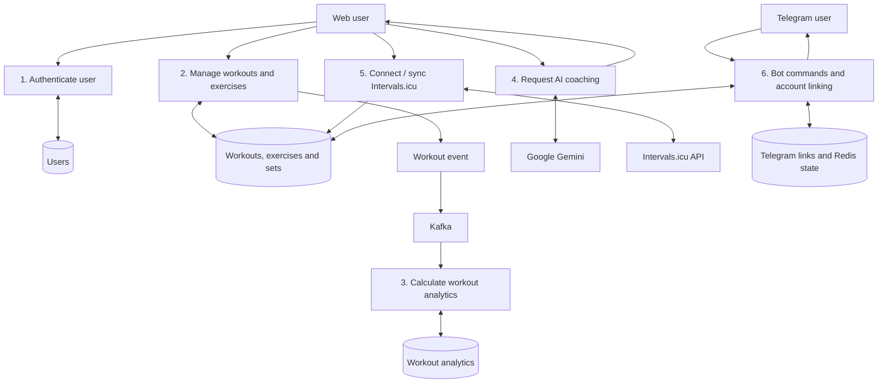
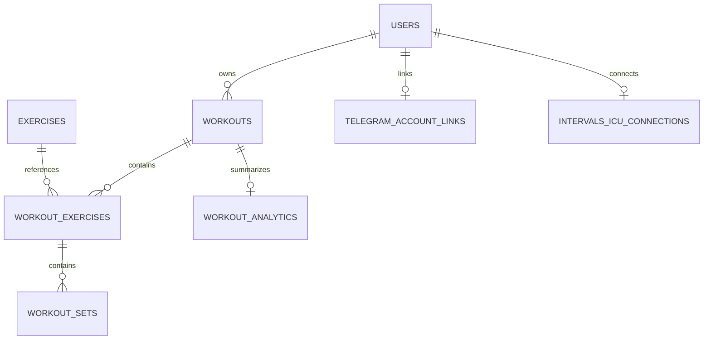

# AI Fitness Coach

**An AI-powered fitness tracking and coaching platform** built with Spring Boot, React, PostgreSQL, Redis, Kafka, Google Gemini, Intervals.icu and Telegram.

AI Fitness Coach brings workout logging, activity synchronization, fitness analytics and an AI coach into one place. Users can manage workouts through the web application, connect their Intervals.icu account to import activities and view planned sessions, and interact with their fitness data through a Telegram bot.

> **Project status:** The core application and production deployment pipeline are implemented. Final-semester work can focus on documentation, end-to-end validation, security review, testing and presentation. See [Known limitations and future work](#known-limitations-and-future-work) before treating every planned enhancement as complete.

## Live application

- **Web application:** https://ai-fitness-coach-frontend.pages.dev
- **Backend API:** https://ai-fitness-coach-api-rahul.centralindia.cloudapp.azure.com
- **Backend health check:** https://ai-fitness-coach-api-rahul.centralindia.cloudapp.azure.com/actuator/health
- **Backend repository:** https://github.com/raahulllkushwaha/ai-fitness-coach
- **Frontend repository:** https://github.com/raahulllkushwaha/ai-fitness-coach-frontend-
- **Backend CI/CD runs:** https://github.com/raahulllkushwaha/ai-fitness-coach/actions

The health endpoint reports whether the backend application is running; it does not guarantee that every external integration (Gemini, Intervals.icu, Telegram or Kafka) is currently available.

## Contents

- [What the system does](#what-the-system-does)
- [Features](#features)
- [Architecture](#architecture)
- [User journeys](#user-journeys)
- [Technology stack](#technology-stack)
- [Repository structure](#repository-structure)
- [Run locally](#run-locally)
- [Environment variables](#environment-variables)
- [Intervalsicu integration](#intervalsicu-integration)
- [Telegram bot](#telegram-bot)
- [API overview](#api-overview)
- [Database and event processing](#database-and-event-processing)
- [Deployment and CI/CD](#deployment-and-cicd)
- [Testing](#testing)
- [Security notes](#security-notes)
- [Troubleshooting](#troubleshooting)
- [Known limitations and future work](#known-limitations-and-future-work)

## What the system does

The application has three main entry points:

1. **Web application:** Users register or log in, record workouts, manage exercises and sets, review analytics, ask the AI coach questions, and connect integrations.
2. **Intervals.icu:** Once a user authorizes the integration, the backend can import completed activities and fetch planned workouts from the Intervals.icu calendar.
3. **Telegram bot:** After linking a Telegram account to an application account, users can ask for recent workout information, weekly summaries, upcoming planned workouts and AI-coach responses without opening the website.

The Spring Boot backend owns the business logic, authentication, persistence and calls to external services. The frontend communicates with the backend through REST APIs; it does not connect directly to the database, Kafka, Redis, Gemini credentials or the Telegram bot token.

## Features

### Accounts and authentication

- User registration and login.
- JWT-based authentication for protected API endpoints.
- User-scoped workout retrieval and management.
- Account profile retrieval and update endpoints.

### Workout management

- Create, read, update and delete workouts.
- Record workout type, start/end time, duration, distance, elevation, heart-rate measurements, calories, pace and notes where applicable.
- Manage exercises attached to workouts.
- Record workout sets, including repetitions, weight, duration, distance and perceived exertion (RPE) where applicable.
- Import completed activities from Intervals.icu.

### Analytics

- Per-workout analytics and date-range summaries.
- Metrics include duration, distance, average speed, pace, calories, heart rate and elevation when available.
- Workout create/update/delete events are processed asynchronously through Kafka to generate or remove associated analytics.
- Event IDs are tracked to reduce duplicate processing.

### AI coaching

- Generate a training recommendation for a selected date range.
- Chat with the AI coach using the backend's Google Gemini integration through Spring AI.
- AI functionality is triggered by explicit user actions rather than automatically making a model request every time the AI page opens.

AI-generated content is informational and should not be treated as medical advice, diagnosis or a substitute for a qualified coach or clinician.

### Intervals.icu integration

- Per-user OAuth authorization flow, including short-lived state and PKCE verifier/challenge handling.
- Store the user's access token encrypted on the backend.
- Check connection status and disconnect the integration.
- Synchronize completed activities and prevent repeat imports using external activity identifiers.
- Retrieve planned workouts from the Intervals.icu calendar.
- Scheduled activity synchronization runs after application startup and then on a recurring interval; the current defaults are a 2-minute initial delay, a 30-minute fixed delay and a recent 3-day sync window.
- Notify a linked Telegram user when newly imported workouts are detected.

### Telegram bot

- Link a Telegram account with a one-time code generated by the web application.
- View account connection status, the latest workout, recent workouts, weekly statistics and upcoming planned workouts.
- Send ordinary text messages to interact with the AI coach.
- Process Telegram updates with Redis-backed offset and duplicate-update tracking.
- Handle account commands in private chats only.

### Responsive web interface

- Dashboard and workout views.
- Workout analytics and AI coaching pages.
- Integration settings for Intervals.icu and Telegram linking.
- Form validation and client-side authentication state management.

## Architecture



### Major components

| Component | Responsibility |
|---|---|
| React/Vite frontend | User interface, forms, navigation, charts and API calls |
| Spring Boot backend | Authentication, business rules, validation, REST controllers and integration coordination |
| PostgreSQL | Durable storage for users, workouts, exercises, sets, analytics and integration links |
| Flyway | Versioned database schema migrations |
| Redis | User cache, OAuth state, Telegram polling offset and duplicate-update tracking |
| Kafka | Asynchronous workout-event processing |
| Google Gemini / Spring AI | AI coach recommendations and conversational responses |
| Intervals.icu API | Completed activity and planned-calendar data |
| Telegram Bot API | Messaging interface, commands and workout-sync notifications |
| GitHub Actions + GHCR + Azure | Automated validation, image publishing and backend deployment |

### Data Flow Diagram — Level 0 (context)



### Data Flow Diagram — Level 1 (main processes)



### Typical workout data model



## User journeys

### Website to workout analytics

1. Open the [web application](https://ai-fitness-coach-frontend.pages.dev) and register or log in.
2. The frontend calls the backend API and uses the returned JWT for protected requests.
3. Create or update a workout and add exercises/sets as needed.
4. The backend persists the workout in PostgreSQL and publishes a workout event.
5. Kafka consumes the event and triggers analytics generation or deletion.
6. The dashboard and analytics screens retrieve the persisted workout and metrics through REST APIs.

### Website to Intervals.icu

1. Log in to the web application and open the Integrations area.
2. Start the Intervals.icu connection flow.
3. The backend creates a short-lived OAuth state and PKCE challenge and redirects the user to Intervals.icu.
4. After authorization, Intervals.icu redirects to the backend callback.
5. The backend exchanges the authorization code, checks the granted scopes and stores the encrypted token for that application user.
6. The user can check connection status, request planned workouts or synchronize activities.
7. A scheduled job periodically checks recent activity history and can notify Telegram when new workouts are imported.

The configured OAuth client, redirect URI and Intervals.icu permissions must be correct. If the calendar API returns an authorization error, reconnect the account and grant the required activity/calendar permissions.

### Website to Telegram bot

1. Log in to the website and open the Telegram integration section.
2. Request a link code from the backend.
3. Open the Telegram bot in a **private chat** and send `/link YOUR_CODE`.
4. The bot validates the code and connects the Telegram identity to the application user.
5. Use commands such as `/lastworkout`, `/recent`, `/summary` and `/upcoming` to query your saved data.
6. Send a normal text message to chat with the AI coach.

### Automatic production deployment

1. Create a feature branch and open a pull request against `main`.
2. GitHub Actions runs the backend verification job.
3. After the change is merged to `main`, the workflow builds and publishes a versioned Docker image to GitHub Container Registry (GHCR).
4. GitHub Actions authenticates to Azure using OpenID Connect (OIDC).
5. Azure VM Run Command executes the deployment script on the VM; no inbound SSH connection from the GitHub-hosted runner is required.
6. The workflow checks the local Actuator health endpoint and fails if the app does not become healthy within the configured window.

## Technology stack

| Layer | Technologies |
|---|---|
| Backend | Java 21, Spring Boot 4.1.1, Spring MVC, Spring Security, Spring Data JPA, Bean Validation |
| AI | Spring AI, Google Gemini |
| Database / migrations | PostgreSQL, Hibernate validation, Flyway |
| Cache and short-lived state | Redis |
| Event-driven processing | Apache Kafka |
| Frontend | React 19, Vite, React Router, Tailwind CSS |
| Frontend state / HTTP | Zustand, Axios |
| Forms / validation | React Hook Form, Zod |
| Analytics visualizations | ApexCharts |
| Interface animation | Framer Motion, GSAP, Lenis, Three.js / React Three Fiber / Drei |
| External integrations | Intervals.icu API, Telegram Bot API |
| Build and deployment | Maven Wrapper, Docker, Docker Compose, GitHub Actions, GHCR, Microsoft Azure VM |

## Repository structure

### Backend repository

```text
src/main/java/com/rahul/aifitness/
├── ai/              # AI coach, chat, tools and AI-specific handling
├── analytics/       # Workout metrics, summaries and analytics service
├── auth/            # Registration, login, JWT-related services
├── common/          # Shared responses and exception handling
├── config/          # Security, Redis, Kafka and password configuration
├── event/kafka/     # Event publishing, consumers and idempotency
├── integration/
│   ├── intervalsicu/ # OAuth, activity sync, planned workouts and scheduler
│   └── telegram/     # Bot, account linking, polling and messaging
├── user/            # User entities, controllers and services
└── workout/         # Workout, exercise, set and related APIs

src/main/resources/db/migration/ # Flyway migration scripts
.github/workflows/backend-ci.yml # Build, test, image publish and Azure deploy
Dockerfile
docker-compose.yml
 docker-compose.prod.yml
.env.example
```

### Frontend repository

```text
src/
├── components/      # Layout, shared UI and visual scene components
├── features/auth/  # Client-side authentication state
├── lib/             # API client and API functions
└── pages/           # Dashboard, workouts, analytics, coach, integrations, profile
```

## Run locally

### Prerequisites

- Java 21
- Docker Engine and Docker Compose plugin
- Git
- Node.js 20.19+ or 22+ and npm (for the frontend)
- A Google Gemini API key for AI features
- A Telegram bot token for Telegram functionality
- Intervals.icu OAuth credentials if you want to test that integration

### 1. Clone the backend

```bash
git clone https://github.com/raahulllkushwaha/ai-fitness-coach.git
cd ai-fitness-coach
cp .env.example .env
```

Open `.env` and replace placeholder values with your own development credentials. Do not commit `.env`.

### 2. Start infrastructure

The development Compose file starts PostgreSQL, Redis and Kafka. It does not start the Spring Boot application itself.

```bash
docker compose up -d postgres redis kafka
docker compose ps
```

Wait until PostgreSQL and Redis report healthy. Confirm Kafka is ready before running integration tests or the application.

### 3. Load environment variables and start the backend

On Linux/macOS, load `.env` into the current shell and run the Spring Boot application:

```bash
set -a
source .env
set +a

./mvnw spring-boot:run
```

The backend listens on `http://localhost:8080`. The default local profile points to PostgreSQL, Redis and Kafka on localhost. The application uses Flyway migrations to initialise/version the schema and Hibernate validates the mappings against it.

Check health:

```bash
curl -i http://localhost:8080/actuator/health
```

Expected response includes a status of `UP` when the application is healthy.

### 4. Run the frontend

Open another terminal:

```bash
git clone https://github.com/raahulllkushwaha/ai-fitness-coach-frontend-.git
cd ai-fitness-coach-frontend-
cp .env.example .env
```

Set the frontend API base URL in `.env`:

```dotenv
VITE_API_BASE_URL=http://localhost:8080
```

Then install dependencies and start Vite:

```bash
npm install
npm run dev
```

Open `http://localhost:5173`.

For a local browser-to-backend connection, the backend CORS configuration must allow `http://localhost:5173`. Do not place backend-only secrets in the frontend `.env`: variables prefixed with `VITE_` are embedded in the client-side build and are public.

### 5. Stop local infrastructure

```bash
docker compose down
```

This stops containers but preserves named volumes. **Avoid `docker compose down -v` unless you deliberately want to delete local database/cache/event data.**

## Environment variables

The backend template is [`.env.example`](.env.example). Update the local `.env` with real values as needed.

| Variable | Purpose | Required for |
|---|---|---|
| `POSTGRES_DB` | PostgreSQL database name | Backend database |
| `POSTGRES_USER` | PostgreSQL username | Backend database |
| `POSTGRES_PASSWORD` | PostgreSQL password | Backend database |
| `POSTGRES_PORT` | Host-side PostgreSQL port, default `5432` | Local development |
| `REDIS_PASSWORD` | Redis authentication password | Redis |
| `REDIS_PORT` | Host-side Redis port | Local development |
| `KAFKA_PORT` | Host-side Kafka port | Local development |
| `JWT_SECRET` | Secret used to sign/validate JWTs | Authentication |
| `JWT_EXPIRATION_SECONDS` | JWT lifetime, default `3600` | Authentication |
| `GEMINI_API_KEY` | Google Gemini API key | AI coach/chat |
| `TELEGRAM_BOT_TOKEN` | Telegram bot token | Telegram bot |
| `INTERVALS_ICU_BASE_URL` | Intervals.icu API base URL; defaults to `https://intervals.icu/api/v1` | Intervals.icu |
| `INTERVALS_API_KEY` | Optional legacy/personal API key integration setting | Legacy/manual sync configuration where used |
| `INTERVALS_OWNER_USER_ID` | User identifier associated with the optional personal-key configuration | Legacy/manual sync configuration where used |
| `INTERVALS_OAUTH_CLIENT_ID` | Intervals.icu OAuth client ID | Per-user OAuth |
| `INTERVALS_OAUTH_CLIENT_SECRET` | Intervals.icu OAuth client secret | Per-user OAuth callback/token exchange |
| `INTERVALS_OAUTH_REDIRECT_URI` | OAuth callback URI registered with Intervals.icu | Per-user OAuth |
| `INTERVALS_TOKEN_ENCRYPTION_KEY` | Key used to encrypt/decrypt stored Intervals.icu access tokens | Secure token storage |

Do not copy real values into documentation, Git commits, screenshots or public issue reports. Production secrets are configured on the Azure host; GitHub deployment uses repository Actions secrets for `AZURE_CLIENT_ID`, `AZURE_TENANT_ID` and `AZURE_SUBSCRIPTION_ID`. The GitHub OIDC federated credential is restricted to this repository's `main` branch.

## Intervals.icu integration

The backend's integration endpoints are listed below. Protected endpoints require a valid JWT.

| Method | Endpoint | Purpose |
|---|---|---|
| `GET` | `/api/v1/integrations/intervals-icu/authorize-url` | Create the authorization URL for the signed-in user |
| `GET` | `/api/v1/integrations/intervals-icu/callback` | OAuth callback; called by Intervals.icu |
| `GET` | `/api/v1/integrations/intervals-icu/status` | Check whether the current user is connected |
| `DELETE` | `/api/v1/integrations/intervals-icu/disconnect` | Disconnect the current user's integration |
| `GET` | `/api/v1/integrations/intervals-icu/planned-workouts?oldest=YYYY-MM-DD&newest=YYYY-MM-DD&limit=50` | Fetch planned calendar workouts |
| `POST` | `/api/v1/integrations/intervals-icu/sync?oldest=YYYY-MM-DD&newest=YYYY-MM-DD&limit=200` | Import completed activities |

For local development, register the callback URI configured in `INTERVALS_OAUTH_REDIRECT_URI` in the Intervals.icu OAuth application. For the hosted backend, the callback URI follows this pattern:

```text
https://ai-fitness-coach-api-rahul.centralindia.cloudapp.azure.com/api/v1/integrations/intervals-icu/callback
```

The OAuth flow requests `ACTIVITY:READ` and `CALENDAR:READ`. If the integration receives HTTP `401` or `403`, check the OAuth application's scope support and reconnect the account with the required permissions. Sync is range-limited and validates dates/limits; imported activity IDs are namespaced so that repeat syncs do not normally create duplicate workouts.

## Telegram bot

Set `TELEGRAM_BOT_TOKEN` on the backend. The token must never be included in the frontend environment or source code.

### Link your account

1. Sign in to the website.
2. Open the integration screen and request a Telegram link code.
3. Open the configured Telegram bot in a private chat.
4. Send `/link CODE`, replacing `CODE` with the generated code.
5. Use `/status` to verify the connection.

### Commands

| Command | Description |
|---|---|
| `/start` | Welcome message and quick help |
| `/help` | List available commands |
| `/status` | Check the linked-account status |
| `/lastworkout` or `/last` | Display the latest workout |
| `/recent` or `/workouts` | Display the last five workouts |
| `/summary` or `/stats` | Display a recent fitness summary (default: last 7 days) |
| `/upcoming` | Display planned workouts for the next seven days |
| `/link CODE` | Link the Telegram account to the application account |

You can also send an ordinary text message to chat with the AI coach. Commands and linked-account data are handled in private chats only.

## API overview

All examples use the backend API origin. Protected requests should include:

```http
Authorization: Bearer <JWT>
```

### Authentication and user

| Method | Endpoint | Purpose |
|---|---|---|
| `POST` | `/api/v1/auth/register` | Register a user |
| `POST` | `/api/v1/auth/login` | Log in and obtain authentication data |
| `GET` | `/api/v1/users/me` | Get the current user's profile |
| `PUT` | `/api/v1/users/me` | Update profile fields supported by the API |

### Workouts and exercises

| Method | Endpoint | Purpose |
|---|---|---|
| `GET` / `POST` | `/api/v1/workouts` | List workouts / create workout |
| `GET` / `PUT` / `DELETE` | `/api/v1/workouts/{workoutId}` | Read, update or delete a workout |
| `GET` | `/api/v1/workouts/type/{workoutType}` | List workouts of a selected type |
| `GET` | `/api/v1/workouts/range?start=...&end=...` | Retrieve workouts within a date/time range |
| `GET` / `POST` | `/api/v1/exercises` | List exercises / create exercise |
| `GET` / `PUT` / `DELETE` | `/api/v1/exercises/{exerciseId}` | Read, update or delete an exercise |
| `GET` / `POST` | `/api/v1/workouts/{workoutId}/exercises/{workoutExerciseId}/sets` | List or add sets for a workout exercise |

### Analytics and AI

| Method | Endpoint | Purpose |
|---|---|---|
| `GET` | `/api/v1/workouts/{workoutId}/analytics` | Get analytics for a workout |
| `GET` | `/api/v1/workouts/analytics/summary?start=...&end=...` | Get analytics for a date/time range |
| `POST` | `/api/v1/workouts/analytics/rebuild-missing` | Rebuild missing analytics for the current user |
| `GET` | `/api/v1/ai/coach?start=...&end=...` | Generate a coaching recommendation |
| `POST` | `/api/v1/ai/chat` | Send a message to the AI coach |
| `POST` | `/api/v1/integrations/telegram/link-code` | Create a Telegram account-link code |

Most APIs use the common `ApiResponse` wrapper. Request DTO validation and authenticated-user ownership checks are handled by the backend. Consult the controllers and DTOs for exact request/response schemas and valid enum values.

## Database and event processing

Flyway migrations manage schema changes. Principal tables include:

- `users` — application accounts and profile data.
- `workouts` — workout timing, type, measurements, source and external ID.
- `exercises` — normalized exercise catalogue.
- `workout_exercises` — exercises assigned to workouts and their display order.
- `workout_sets` — per-set repetitions, weight, duration, distance and RPE.
- `workout_analytics` — derived per-workout metrics.
- `telegram_account_links` — user-to-Telegram account mapping.
- `intervals_icu_connections` — per-user encrypted OAuth token, scopes and sync timestamps.

When a workout is created, updated or deleted, a workout event is published to Kafka. The consumer processes the event and updates or removes the associated analytics. Idempotency state helps avoid processing the same event multiple times. Redis also stores short-lived OAuth state and Telegram polling/deduplication data.

## Deployment and CI/CD

### Backend

The backend is deployed to an Azure Linux VM using Docker Compose. Production infrastructure includes PostgreSQL, Redis, Kafka and the Spring Boot application. The production Compose file expects the server-side `.env` file to exist and supplies the real database credentials and provider tokens.

The production app image is published to GHCR as:

```text
ghcr.io/raahulllkushwaha/ai-fitness-coach-backend:<commit-sha>
```

### GitHub Actions pipeline

The backend workflow is `.github/workflows/backend-ci.yml` and has three jobs:

1. **Build, Test and Package** — starts PostgreSQL, Redis and Kafka, runs `./mvnw verify`, and verifies a Docker build.
2. **Publish production Docker image** — after successful CI on `main`, builds and pushes `latest` and commit-SHA tags to GHCR.
3. **Deploy to Azure VM** — authenticates with Azure using OIDC and invokes Azure VM Run Command to pull the tagged image, recreate the application container and wait for `/actuator/health` to report `UP`.

The current deployment flow does not require inbound SSH access from GitHub-hosted runners. Keep the GitHub OIDC federated credential restricted to the intended repository and `main` branch. Ensure the Azure VM has the Azure VM Agent, Docker Compose, access to GHCR and a correctly configured production `.env` file.

### Frontend

The frontend is hosted on Cloudflare Pages at the live web URL above. Its GitHub Actions workflow (`frontend-ci.yml`) validates lint and production build. Production static-site deployment is managed by the configured Cloudflare Pages/Git integration; frontend source changes should be merged into the frontend repository's `main` branch.

## Testing

### Backend

The CI workflow starts the supporting services and runs:

```bash
./mvnw --batch-mode --no-transfer-progress verify
```

For a local test run, load the `.env` variables and start PostgreSQL, Redis and Kafka first. Some integration tests may require those services to be reachable.

### Frontend

```bash
npm run lint
npm run build
```

### Manual end-to-end checklist

- Register a new user and log in.
- Create, list, update and delete a test workout.
- Attach an exercise and add sets.
- Confirm workout analytics are generated after workout events are processed.
- Ask the AI coach for a recommendation and send an AI chat message.
- Connect an Intervals.icu account, fetch planned workouts and sync an activity date range.
- Link Telegram with a one-time code; test `/status`, `/lastworkout`, `/recent`, `/summary` and `/upcoming`.
- Merge a small change into backend `main` and confirm all three CI/CD jobs pass.
- Confirm the live health endpoint returns `UP` and test the deployed UI against the API.

Use a non-critical test account and test workout for destructive operations.

## Security notes

- Never commit `.env`, JWT signing secrets, database passwords, Gemini API keys, Telegram tokens, Intervals.icu client secrets or token-encryption keys.
- Frontend variables beginning with `VITE_` are public and bundled into browser assets.
- The backend stores JWT-authenticated application data and encrypted Intervals.icu access tokens; protect production secrets and database backups accordingly.
- The frontend currently stores the JWT in browser local storage. For a more security-sensitive production deployment, evaluate an HttpOnly, Secure, SameSite cookie-based design and strengthen CSP/XSS protections.
- Limit Azure permissions to the VM and required deployment actions; do not grant broad subscription permissions without a documented reason.
- Keep administrative ports closed to the internet when not required. The current GitHub-to-Azure deployment uses OIDC and Run Command rather than opening SSH to GitHub-hosted runners.
- AI coaching is informational; users should verify recommendations and consult qualified professionals for medical concerns.

## Troubleshooting

| Symptom | What to check |
|---|---|
| Backend fails to start due to missing variables | Confirm `.env` exists, source it into the shell, and verify required variables are populated. |
| PostgreSQL connection refused | Check `docker compose ps`, container health, `POSTGRES_PORT`, username/database/password and port conflicts. |
| Redis authentication/connectivity errors | Check `REDIS_PASSWORD`, Redis container health and the configured Redis host/port. |
| Kafka not ready or analytics delayed | Check Kafka container status/logs and whether the event consumer is running without repeated errors. |
| AI calls fail | Check `GEMINI_API_KEY`, provider availability/quota and backend logs; AI calls may consume provider quota. |
| Intervals.icu returns 401/403 | Reconnect the account, verify OAuth client configuration/redirect URI and required `ACTIVITY:READ` and `CALENDAR:READ` permissions. |
| Telegram does not respond | Confirm `TELEGRAM_BOT_TOKEN`, bot reachability, private chat, account link status, Redis health and backend logs. |
| CI deployment is green but UI looks old | Verify Cloudflare Pages has deployed the newest frontend commit and that `VITE_API_BASE_URL` points to the intended backend. |
| Azure deployment job fails | Open the failed job logs. Check OIDC federated credential, GitHub Actions secrets, Azure VM resource group/name, VM Agent, production `.env`, GHCR pull access and application health. |

## Known limitations and future work

- Review and complete full end-to-end testing with real integration accounts and representative data.
- Confirm automatic Intervals.icu sync imports newly available activities in the target account and check the scheduler's logs for failures.
- The Fitness Profile preference form currently stores preferences in the browser; server-side persistence and passing those preferences into AI context remain future work.
- Revisit JWT storage and the wider production security posture before inviting additional users.
- Add monitoring/alerting, database backup-and-restore testing and resource-capacity checks for the Azure VM.
- Add formal API schema documentation (for example, OpenAPI) and expand automated tests around OAuth, sync failures, duplicate imports and Telegram account linking.

## Acknowledgements and references

- [Spring Boot](https://spring.io/projects/spring-boot)
- [Spring AI](https://spring.io/projects/spring-ai)
- [React](https://react.dev/)
- [PostgreSQL](https://www.postgresql.org/)
- [Redis](https://redis.io/)
- [Apache Kafka](https://kafka.apache.org/)
- [Intervals.icu](https://intervals.icu/)
- [Telegram Bot API](https://core.telegram.org/bots/api)
- [GitHub Actions](https://docs.github.com/actions)
- [Microsoft Azure Virtual Machines](https://learn.microsoft.com/azure/virtual-machines/)

---

**Maintainer:** Project repository owner  
**Backend:** Java / Spring Boot  
**Frontend:** React / Vite
